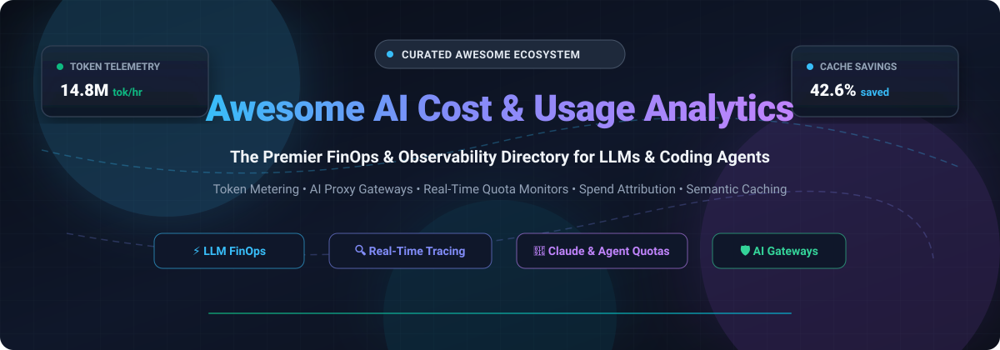

<p align="center">
  
</p>

# 💰 Awesome AI Cost & Usage Analytics

<p align="center">
  <a href="https://github.com/ishandutta2007/Awesome-Awesome-Awesome"></a><a href="https://discord.gg/jc4xtF58Ve"></a>
  <a href="https://github.com/ishandutta2007/Awesome-AI-Cost-Usage-Analytics/stargazers"></a>
  <a href="https://github.com/ishandutta2007/Awesome-AI-Cost-Usage-Analytics/network/members"></a>
  <a href="https://github.com/ishandutta2007/Awesome-AI-Cost-Usage-Analytics/issues"></a>
  <a href="https://github.com/ishandutta2007/Awesome-AI-Cost-Usage-Analytics/blob/main/LICENSE"></a>
  <a href="https://github.com/ishandutta2007"></a>
</p>

---

## 🧭 Executive Overview & SEO Meta

A comprehensive, curated landscape of top **AI Cost & Usage Analytics SaaS products** and **Open-Source GitHub projects**. Engineered for engineering managers, AI FinOps practitioners, platform engineers, and AI developers navigating multi-provider LLM billing, token quota caps, agent spend tracking (`Claude Code`, `Cursor`, `Codex`), semantic caching savings, and self-hosted AI gateway architectures.

* **Keywords**: `AI FinOps`, `LLM Observability`, `Token Usage Analytics`, `Claude Code Usage Monitor`, `AI Cost Optimization`, `LLM Gateway`, `Semantic Caching`, `Token Metering`, `Prompt Cost Calculator`, `Multi-Tenant AI Billing`.
* **Last Updated**: November 2026 🚀

---

## 📑 Table of Contents

- [📊 Sector Overview & Market Dynamics](#-sector-overview--market-dynamics)
- [☁️ SaaS & Hosted Platforms](#️-saas--hosted-platforms)
- [💻 Open-Source GitHub Projects](#-open-source-github-projects)
- [🛠️ Architecture & Recommended Stacks](#️-architecture--recommended-stacks)
- [📈 Star History](#-star-history)
- [🤝 How to Contribute](#-how-to-contribute)
- [💖 Support & Sponsorship](#-support--sponsorship)
- [📜 Disclaimer](#-disclaimer)

---

## 📊 Sector Overview & Market Dynamics

The global **AI FinOps and LLM Observability sector** represents a rapidly expanding market valued at over **$16.8 billion in 2026** (with specialized LLM observability scaling at a **36%+ CAGR** toward **$9.3 billion by 2030**). As enterprise generative AI shifts from proof-of-concept experimentation to multi-agent production systems, over 98% of FinOps practitioners now actively monitor and govern AI token spend.

The market currently exhibits **moderate fragmentation with rapid enterprise consolidation** rather than a winner-take-all outcome:
* **Infrastructure Giants & Enterprise APM**: Cloud platforms and cybersecurity giants are acquiring breakout gateway and tracing players (e.g., ClickHouse acquiring *Langfuse*, Palo Alto Networks acquiring *Portkey*, Cisco/Splunk acquiring *Galileo*, and Datadog building native LLM spans) to control end-to-end enterprise telemetry.
* **Specialized High-Velocity Upstarts**: Dynamic model routers (e.g., *Martian*), modular open-source gateways (e.g., *LiteLLM*, *TensorZero*, *Helicone*), and real-time local agent monitors (e.g., *ccusage*, *Claude-Code-Usage-Monitor*) remain agile, capturing massive developer mindshare across hybrid cloud and local agentic environments.

---

## ☁️ SaaS & Hosted Platforms

Below is a detailed analysis of leading commercial platforms for AI cost attribution, rate limiting, and token telemetry, **ranked by company size (valuation / public market cap)** in descending order:

| 🏢 Platform | 💰 Starting Tier Price | 🎁 Free Tier / Trial Limits | 📈 Company Size (Valuation / Revenue) | 🔍 Key Capabilities & Focus |
| :--- | :--- | :--- | :--- | :--- |
| **[Cloudflare AI Gateway](https://developers.cloudflare.com/ai-gateway/)** | **$5.00 / month** *(Workers Paid starting tier; core AI Gateway proxy features are free)* | **Free Forever plan**: Capped at **200,000 logs/day** (3-day retention), up to 10 gateways per account, and 100,000 Worker requests/day | **~$35B Market Cap** *(Publicly traded: NYSE: NET)* | Global edge proxy network, built-in DDoS protection, unified provider billing, auto-routing, semantic response caching, and DLP security scanning. |
| **[Datadog LLM Observability](https://www.datadoghq.com/product/llm-observability/)** | **$160.00 / month** *(Pro plan includes up to 100,000 LLM spans)* | **Free Forever tier**: **40,000 LLM spans per month** at no cost *(or 14-day free trial on full Datadog infrastructure suite)* | **~$40B Market Cap** *(Publicly traded: NASDAQ: DDOG)* | Unified enterprise APM and agent tracing, token consumption alerts, latency bottleneck root-cause analysis, and end-to-end infrastructure correlation. |
| **[Martian](https://withmartian.com)** | **$0.00 base platform fee + usage-based model rates** *(pay-as-you-go router token pricing)* | **Free trial with introductory developer API credits** *(usage-based after initial credits; enterprise custom quotas on request)* | **~$1.3B Valuation** *(Backed by NEA, Prosus, General Catalyst & Accenture Ventures)* | Dynamic ML model routing engine that intercepts incoming prompts and dispatches each to the lowest-cost model capable of satisfying benchmark requirements. |
| **[Portkey](https://portkey.ai)** | **$49.00 / month** *(Pro plan for scalable team production)* | **Free Forever Developer Plan**: Up to **10,000 recorded logs per month** (3 days log retention, 30 days metrics retention; excess traffic unblocked) | **~$60M Valuation** *(Acquired by Palo Alto Networks in May 2026; Series A raised $15M)* | Enterprise AI gateway, virtual API keys with hard/soft spend caps, automatic fallback routing, semantic caching, and team chargeback dashboards. |
| **[Helicone](https://helicone.ai)** | **$79.00 / month** *(Pro plan includes longer retention, higher rate limits, and custom alerts)* | **Free Forever Hobby Plan**: Up to **10,000 requests per month**, 1 GB storage, 1 seat, and 7 days data retention | **~$25M Valuation** *(Seed funding of $5M in Sept 2024; ~$1M ARR; backed by Y Combinator)* | Lightweight proxy gateway, per-user/per-tenant spend attribution, semantic caching savings telemetry, threat detection, and custom budget alerts. |
| **[Langfuse Cloud](https://langfuse.com)** | **$29.00 / month** *(Core plan includes 100,000 units/mo, unlimited users, and 90-day retention)* | **Free Forever Hobby Plan**: **50,000 units / month** (traces, observations, scores), 2 user seats, 30 days data retention, 1,000 req/min | **Acquired by ClickHouse** *(Parent valuation ~$15B Series D; previously raised $4.5M seed led by Lightspeed)* | Trace- and session-level cost rollups, automated multi-provider model pricing catalog, prompt management, and score/evaluation tracking. |
| **[PromptLayer](https://promptlayer.com)** | **$49.00 / month** *(Pro plan for collaboration and analytics)* | **Free Forever plan**: **2,500 requests per month**, 250 evaluation executions, and up to 10 active managed prompts | **~$4.8M Total Seed Funding** *(Backed by ScOp VC, Stellation Capital; ~$1M estimated ARR)* | Prompt CMS, template-level cost and token attribution, visual versioning, latency benchmarking, and interactive LLM regression testing. |
| **[BerriAI (LiteLLM Cloud)](https://litellm.ai)** | **$100.00 / month** *(Enterprise / Hosted LiteLLM Proxy licenses start at $100/mo or custom annual)* | **Free Forever Open Source plan**: **Unlimited self-hosted requests** (100% free under MIT license, no software request caps) | **~$1.6M Seed Funding** *(Backed by Y Combinator, Pioneer Fund; widely adopted by Fortune 500)* | Hosted control plane for LiteLLM Proxy, providing centralized multi-provider spend governance, SSO, team chargebacks, and budget enforcement. |
| **[Keywords AI](https://keywordsai.co)** | **$7.00 / user / month** *(Entry collaborator tier; pay-as-you-go proxy usage)* | **Free Forever plan**: Up to **2,000 logs per month** *(plus $15 in introductory developer testing credits)* | **~$500K Seed Funding** *(Estimated ~$1.1M ARR; Y Combinator backed)* | Unified OpenAI-compatible gateway endpoint, complete cost analytics per API user, latency metrics, automatic fallbacks, and user rate limits. |

---

## 💻 Open-Source GitHub Projects

Explore the most prominent open-source repositories powering LLM FinOps, token counting, local CLI usage monitors, and high-throughput AI gateways. **Sorted in descending order by GitHub_Stars** ⭐:

| 🌟 Stargazers Badge | 📦 Project Name | 💻 Repository Link | 📝 Description & Architectural Role |
| :---: | :--- | :--- | :--- |
| [](https://github.com/ollama/ollama/stargazers) | **Ollama** | [`ollama/ollama`](https://github.com/ollama/ollama) | Ultra-popular framework for running open-weight LLMs locally and on private clusters with Prometheus token throughput metrics to eliminate third-party cloud API costs. |
| [](https://github.com/vllm-project/vllm/stargazers) | **vLLM** | [`vllm-project/vllm`](https://github.com/vllm-project/vllm) | High-throughput, memory-efficient LLM serving engine featuring PagedAttention and built-in token-level throughput, latency, and cost telemetry. |
| [](https://github.com/BerriAI/litellm/stargazers) | **LiteLLM Proxy** | [`BerriAI/litellm`](https://github.com/BerriAI/litellm) | Industrial-grade AI gateway proxy across 100+ LLMs with virtual keys, team/user budget caps, rate limiting, and real-time spend analytics. |
| [](https://github.com/langfuse/langfuse/stargazers) | **Langfuse** | [`langfuse/langfuse`](https://github.com/langfuse/langfuse) | Self-hostable open-source LLM engineering platform featuring automated token pricing tables, hierarchical trace/session cost rollups, and prompt usage dashboards. |
| [](https://github.com/songquanpeng/one-api/stargazers) | **One-API** | [`songquanpeng/one-api`](https://github.com/songquanpeng/one-api) | Widely deployed multi-provider LLM key aggregation and billing gateway featuring granular token quota management, rate limiting, and consumption logs. |
| [](https://github.com/comet-ml/opik/stargazers) | **Opik** | [`comet-ml/opik`](https://github.com/comet-ml/opik) | Open-source LLM evaluation, tracing, and operational cost monitoring platform by Comet for end-to-end agent token spend tracking. |
| [](https://github.com/openai/tiktoken/stargazers) | **tiktoken** | [`openai/tiktoken`](https://github.com/openai/tiktoken) | Ultra-fast BPE token counter library by OpenAI used for pre-flight prompt counting, context budget enforcement, and cost pre-calculation. |
| [](https://github.com/ryoppippi/ccusage/stargazers) | **ccusage** | [`ryoppippi/ccusage`](https://github.com/ryoppippi/ccusage) | Blazing-fast CLI analyzer for parsing local Claude Code JSONL logs to display daily, monthly, and session token usage, cache hits, and USD spend. |
| [](https://github.com/Portkey-AI/gateway/stargazers) | **Portkey AI Gateway** | [`Portkey-AI/gateway`](https://github.com/Portkey-AI/gateway) | Ultra-fast open-source TypeScript AI gateway with multi-provider routing, automatic retries, budget enforcement headers, and sub-millisecond overhead. |
| [](https://github.com/Arize-ai/phoenix/stargazers) | **Phoenix** | [`Arize-ai/phoenix`](https://github.com/Arize-ai/phoenix) | AI observability and evaluation platform by Arize AI providing trace analysis, invocation costs, and detailed LLM token metrics. |
| [](https://github.com/tensorzero/tensorzero/stargazers) | **TensorZero** | [`tensorzero/tensorzero`](https://github.com/tensorzero/tensorzero) | High-performance LLM gateway and optimization engine written in Rust with ClickHouse-backed cost, latency, and token attribution analytics. |
| [](https://github.com/huggingface/tokenizers/stargazers) | **Tokenizers** | [`huggingface/tokenizers`](https://github.com/huggingface/tokenizers) | Fast tokenizer library by Hugging Face for pre-flight token count validation, batch truncation, and strict inference cost governance. |
| [](https://github.com/maximhq/bifrost/stargazers) | **Bifrost** | [`maximhq/bifrost`](https://github.com/maximhq/bifrost) | High-throughput AI gateway built in Go featuring virtual key budgets, multi-provider fallback routing, and OpenTelemetry usage telemetry. |
| [](https://github.com/Maciek-roboblog/Claude-Code-Usage-Monitor/stargazers) | **Claude-Code-Usage-Monitor** | [`Maciek-roboblog/Claude-Code-Usage-Monitor`](https://github.com/Maciek-roboblog/Claude-Code-Usage-Monitor) | Real-time terminal dashboard built with Rich monitoring Claude Code token burn velocity, 5-hour session reset countdowns, and plan exhaustion warnings. |
| [](https://github.com/zilliztech/GPTCache/stargazers) | **GPTCache** | [`zilliztech/GPTCache`](https://github.com/zilliztech/GPTCache) | Open-source semantic caching framework that intercepts repeated LLM queries to dramatically slash cloud API token costs and latency. |
| [](https://github.com/traceloop/openllmetry/stargazers) | **OpenLLMetry** | [`traceloop/openllmetry`](https://github.com/traceloop/openllmetry) | OpenTelemetry instrumentation suite exporting standardized `gen_ai.usage.input_tokens` and operational cost metrics to Datadog, Prometheus, or Grafana. |
| [](https://github.com/Helicone/helicone/stargazers) | **Helicone** | [`Helicone/helicone`](https://github.com/Helicone/helicone) | Open-source observability proxy enabling self-hosted request logging, token/cost breakdowns, caching savings tracking, and rate limiting. |
| [](https://github.com/AgentOps-AI/AgentOps/stargazers) | **AgentOps** | [`AgentOps-AI/AgentOps`](https://github.com/AgentOps-AI/AgentOps) | Autonomous AI agent observability suite tracking multi-agent tool execution spend, recursive loop costs, and token burn rates. |
| [](https://github.com/lm-sys/RouteLLM/stargazers) | **RouteLLM** | [`lm-sys/RouteLLM`](https://github.com/lm-sys/RouteLLM) | Framework by LMSYS for training and deploying cost-aware LLM routers that dynamically route simpler prompts to cheaper models while preserving output quality. |
| [](https://github.com/openlit/openlit/stargazers) | **OpenLIT** | [`openlit/openlit`](https://github.com/openlit/openlit) | OpenTelemetry-native AI FinOps platform delivering zero-code GPU and token cost metrics with customized pricing catalog support. |
| [](https://github.com/phuryn/claude-usage/stargazers) | **claude-usage** | [`phuryn/claude-usage`](https://github.com/phuryn/claude-usage) | Lightweight macOS menu-bar utility and CLI monitor for tracking real-time Claude Code and Claude subscription quota consumption and session burn rates. |
| [](https://github.com/AgentOps-AI/tokencost/stargazers) | **TokenCost** | [`AgentOps-AI/tokencost`](https://github.com/AgentOps-AI/tokencost) | Utility library for calculating exact USD prompt and completion costs across hundreds of commercial LLMs with zero API overhead. |
| [](https://github.com/bricks-cloud/BricksLLM/stargazers) | **BricksLLM** | [`bricks-cloud/BricksLLM`](https://github.com/bricks-cloud/BricksLLM) | Cloud-native AI gateway written in Go providing enterprise API key management, granular spend limits, rate policies, and Prometheus usage telemetry. |
| [](https://github.com/hoangsonww/Claude-Code-Agent-Monitor/stargazers) | **Claude-Code-Agent-Monitor** | [`hoangsonww/Claude-Code-Agent-Monitor`](https://github.com/hoangsonww/Claude-Code-Agent-Monitor) | Real-time web dashboard for tracking Claude Code sub-agent executions, prompt tokens, session limits, and tool-invocation costs. |

---

## 🛠️ Architecture & Recommended Stacks

For production systems, the most robust AI FinOps architectures combine complementary layers:

```
[Client / Agent / IDE] 
       │
       ▼
 [Pre-Flight Budgeting] ──► tiktoken / tokenizers (context length checks & truncation)
       │
       ▼
  [AI Proxy Gateway]    ──► LiteLLM / TensorZero / Portkey Gateway (virtual keys & spend caps)
       │
       ├─► [Semantic Cache] ──► GPTCache (drop token spend on repetitive queries)
       ├─► [Cost Router]    ──► RouteLLM / Martian (dispatch to cheaper models)
       │
       ▼
[Cloud / Local LLMs]    ──► OpenAI / Anthropic / vLLM / Ollama
       │
       ▼
[Observability & FinOps]──► Langfuse / Helicone / OpenLIT / OpenLLMetry (cost rollups)
```

---

## 📈 Star History

[](https://www.star-history.com/#ishandutta2007/Awesome-AI-Cost-Usage-Analytics&type=date&legend=top-left)

---

## 🤝 How to Contribute

Contributions are warmly encouraged! Help keep this curated ecosystem fresh and up to date:

1. **Fork the repository** 🍴
2. **Create a descriptive feature branch** (`git checkout -b feature/add-new-finops-tool`)
3. **Add or update an entry**: Ensure accurate pricing, specific free tier limits, Stars_Badges, and links.
4. **Commit your updates** (`git commit -m "Add NewTool to Open-Source FinOps"`)
5. **Push and open a Pull Request** 🚀

---

## 💖 Support & Sponsorship

If you find this curated directory helpful for optimizing your AI infrastructure spend and token analytics, thank you for supporting the project!

- ⭐ **Star this repository** on GitHub to help others discover it.
- 🍴 **Fork and share** with fellow FinOps practitioners and AI engineers.
- ☕ **Buy me a coffee / Sponsor**: If you'd like to support ongoing updates, please visit the [GitHub Sponsors Dashboard](https://github.com/sponsors/ishandutta2007).

---

## 📜 Disclaimer

*All trademarks, logos, and brand names belong to their respective owners. Product pricing, free tier limits, and valuations fluctuate over time and reflect publicly available market data as of late 2026. Please consult official provider documentation for current enterprise billing rates.*
